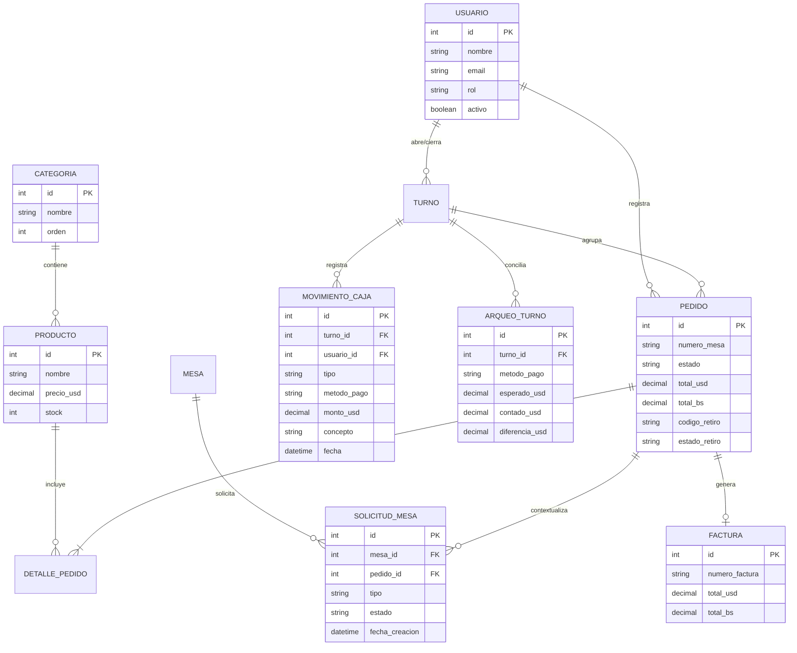

# 📊 DATABASE.md — Modelo Relacional de Datos

Este documento define la arquitectura física de la base de datos relacional de **DONDE DAVID - FRESH & TASTY!**.

---

## 📐 Diagrama Entidad-Relación (Mermaid)



## Migraciones y operación inicial

Las migraciones Alembic son la fuente de verdad del esquema (`alembic check` alineado con modelos ORM); la revisión `f9c1d2e3a4b5_align_auditoria_constraints.py` alinea `auditoria.detalle` (`VARCHAR(500)`), `auditoria.fecha` (`NOT NULL`), índice `ix_auditoria_usuario_id` y clave foránea `fk_auditoria_usuario_id_usuarios` (`ON DELETE SET NULL`). El archivo `restaurante.db` fue desindexado de Git (`git rm --cached`) para evitar contaminación del repositorio; para desarrollo local se crea/migra al arrancar o mediante `alembic upgrade head`.

Las mutaciones concurrentes críticas (stock de productos en `services/orders.py`, turnos y cobros en `caja.py`, transiciones en `cocina.py` y `mesero.py`, canje de puntos en `cliente.py`) aplican bloqueos de fila (`with_for_update()`) ordenados determinísticamente por `producto_id`. La restauración de respaldos PostgreSQL en `services/backup_service.py` valida tablas/columnas contra `Base.metadata`, ordena topológicamente el vaciado e inserción, normaliza tipos y reinicia secuencias (`setval(pg_get_serial_sequence(...))`).

El reinicio de una base local es destructivo. Antes de recrearla, copia los archivos SQLite existentes a `backend/backups/` o fuera del repositorio y confirma que la aplicación esté detenida. No ejecutes un reinicio de bases en producción. No se integra una pasarela de pago de terceros en esta versión.

---

## 🗄️ Esquema DDL SQL

```sql
-- Usuarios
CREATE TABLE usuarios (
    id INT PRIMARY KEY AUTO_INCREMENT,
    nombre VARCHAR(100) NOT NULL,
    apellido VARCHAR(100) NOT NULL,
    email VARCHAR(255) UNIQUE NOT NULL,
    nombre_usuario VARCHAR(50) UNIQUE NOT NULL,
    contraseña_hash VARCHAR(255) NOT NULL,
    rol ENUM('admin','supervisor','gerente','caja','cocina','cliente','mesero','repartidor') NOT NULL,
    activo BOOLEAN DEFAULT TRUE,
    fecha_creacion DATETIME DEFAULT CURRENT_TIMESTAMP
);

-- Categorías
CREATE TABLE categorias (
    id INT PRIMARY KEY AUTO_INCREMENT,
    nombre VARCHAR(100) UNIQUE NOT NULL,
    descripcion VARCHAR(255),
    icono VARCHAR(50),
    orden INT DEFAULT 0,
    activo BOOLEAN DEFAULT TRUE
);

-- Productos
CREATE TABLE productos (
    id INT PRIMARY KEY AUTO_INCREMENT,
    nombre VARCHAR(150) NOT NULL,
    descripcion TEXT,
    precio_usd DECIMAL(10,2) NOT NULL,
    precio_promocion_usd DECIMAL(10,2),
    stock INT DEFAULT 0,
    stock_minimo INT DEFAULT 5,
    imagen_url VARCHAR(255),
    tiempo_preparacion INT DEFAULT 15,
    alergenos VARCHAR(500),
    disponible BOOLEAN NOT NULL DEFAULT TRUE,
    activo BOOLEAN DEFAULT TRUE,
    categoria_id INT NOT NULL,
    FOREIGN KEY (categoria_id) REFERENCES categorias(id)
);

-- Configuraciones
CREATE TABLE configuraciones (
    id INT PRIMARY KEY AUTO_INCREMENT,
    clave VARCHAR(100) UNIQUE NOT NULL,
    valor VARCHAR(500) NOT NULL,
    descripcion VARCHAR(255)
);

-- Turnos
CREATE TABLE turnos (
    id INT PRIMARY KEY AUTO_INCREMENT,
    numero_turno INT NOT NULL,
    fecha_apertura DATETIME DEFAULT CURRENT_TIMESTAMP,
    fecha_cierre DATETIME,
    monto_apertura_usd DECIMAL(10,2) DEFAULT 0.00,
    monto_cierre_usd DECIMAL(10,2),
    total_ventas_usd DECIMAL(10,2) DEFAULT 0.00,
    tasa_cambio_apertura DECIMAL(10,2),
    activo BOOLEAN DEFAULT TRUE,
    usuario_caja_id INT NOT NULL,
    FOREIGN KEY (usuario_caja_id) REFERENCES usuarios(id)
);

-- Pedidos
CREATE TABLE pedidos (
    id INT PRIMARY KEY AUTO_INCREMENT,
    numero_mesa VARCHAR(10),
    tipo ENUM('mesa','delivery','para_llevar') NOT NULL,
    estado ENUM('pendiente','en_preparacion','listo','entregado','cancelado') NOT NULL,
    total_usd DECIMAL(10,2) NOT NULL DEFAULT 0.00,
    total_bs DECIMAL(10,2) NOT NULL DEFAULT 0.00,
    tasa_cambio_aplicada DECIMAL(10,2),
    fecha_creacion DATETIME DEFAULT CURRENT_TIMESTAMP,
    fecha_pago DATETIME NULL,
    usuario_id INT NOT NULL,
    turno_id INT,
    FOREIGN KEY (usuario_id) REFERENCES usuarios(id),
    FOREIGN KEY (turno_id) REFERENCES turnos(id)
);
```
